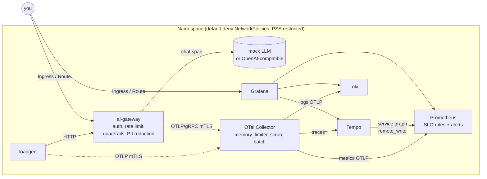

# LLM Observability Lab

**An AI gateway in front of an LLM, fully instrumented with OpenTelemetry and deployed as a hardened, namespace-scoped observability stack. One command brings it up on a laptop (k3d) or in the free Red Hat OpenShift Developer Sandbox.**

[](https://github.com/Mistral-valaise/llm-observability-lab/actions/workflows/ci.yaml)

Think of the gateway as a toll station in front of the LLM: every vehicle is counted, weighed, billed and checked for suspicious cargo. Grafana is the control room that sees all of it.

| What you see | How it is built |
| --- | --- |
| Tokens, cost and latency per tenant and model | OTel **GenAI semantic conventions** (`gen_ai.client.token.usage`, `gen_ai.client.operation.duration`) |
| One click from a latency spike to the exact slow trace, and from the trace to its logs | Exemplars in Prometheus, `trace_id` as structured metadata in Loki, Grafana correlations |
| Error-budget burn-rate alerts with runbooks | Multiwindow SLO rules (Google SRE workbook), `make chaos` to trigger them |
| Prompt-injection blocks, PII redaction, rate limiting, auth failures as metrics | Guardrails in the gateway, security panels and alerts |
| Telemetry that cannot be spoofed or sniffed | OTLP over **mutual TLS**, collector rejects clients without a certificate |
| Zero-trust networking | **Default-deny NetworkPolicies**, one explicit allow rule per data flow |
| Least privilege everywhere | Non-root, read-only root FS, all capabilities dropped, PSS `restricted`, no ClusterRoles |
| Trustworthy supply chain | Multi-arch image with SBOM and provenance, **keyless Cosign signature**, vulnerability scan in CI |

## Architecture



Every arrow is one NetworkPolicy rule. Everything runs in a single namespace without cluster-admin, which is exactly what the OpenShift Developer Sandbox allows.

## Quick start (local, about 5 minutes)

Prerequisites: Docker, [k3d](https://k3d.io), kubectl, [Helm 3](https://helm.sh), [Helmfile](https://helmfile.readthedocs.io) and the [helm-diff](https://github.com/databus23/helm-diff) plugin.

```bash
make up            # k3d cluster + image build + full stack
make smoke         # end-to-end check: request -> trace, metrics, logs; security checks
make urls          # Grafana: http://grafana.localtest.me:8080 (user admin)
make grafana-password
```

Open the **AI Gateway - LLM Observability** dashboard. The load generator is already sending traffic, including PII, prompt-injection attempts and bursts from a noisy tenant.

```bash
make chaos         # 25 % upstream errors + 2 s latency: watch the burn rate climb and the alert fire
make calm          # back to normal
make down          # delete everything
```

Call the gateway yourself:

```bash
KEY=$(make -s keys | head -1 | cut -d= -f2-)
curl -s http://gateway.localtest.me:8080/v1/chat/completions \
  -H "Authorization: Bearer $KEY" -H 'content-type: application/json' \
  -d '{"model":"mock-small","messages":[{"role":"user","content":"What is an SLO?"}]}' -i | grep -i x-trace-id
```

Paste the trace ID into Grafana Explore (Tempo) to follow the request end to end.

## OpenShift Developer Sandbox

1. Get a free sandbox at <https://developers.redhat.com/developer-sandbox> and copy the login command (`oc login --token=... --server=...`).
2. The image comes from GHCR. After the first release run, set the package `ai-gateway` to **public** in GitHub (Packages > Package settings), or the Sandbox cannot pull it.
3. Deploy:

```bash
make up ENV=sandbox      # preflight (permissions, quota) + helmfile apply
make urls ENV=sandbox    # Routes with edge TLS
make smoke ENV=sandbox
```

What changes for the Sandbox (see `deploy/environments/sandbox.yaml.gotmpl`): OpenShift Routes instead of Ingress, no fixed UIDs (restricted-v2 SCC assigns them), the OpenShift ingress namespace label in the NetworkPolicies, smaller PVCs. The Sandbox idles workloads after 12 hours; `make up ENV=sandbox` brings them back.

## Choose your components

Every component is a Helmfile release with an on/off switch in `deploy/environments/default.yaml`.

```bash
make up DISABLE="loki tempo"          # metrics only
make up DISABLE="loadgen"             # quiet gateway, drive traffic yourself
make template ENV=sandbox             # render manifests to out/ without a cluster
```

Use a real model instead of the mock: set `gateway.provider: openai` and point `gateway.upstream.baseUrl` at OpenAI, Ollama or vLLM; put the API key in a Secret and reference it via `gateway.upstream.existingSecret`. Add an egress rule for the upstream in `networkPolicy.extraEgress`.

## Repository layout

```
apps/ai-gateway/          FastAPI gateway + load generator, OTel SDK, tests, Dockerfile
charts/ai-gateway/        Helm chart: gateway, loadgen, API-key Secret, NetworkPolicies
charts/lab-platform/      mTLS certificates, default-deny NetworkPolicies, dashboards, Ingress/Route
deploy/environments/      k3d and sandbox settings, component switches, pinned chart versions
deploy/values/            values for collector, Prometheus (+ SLO rules), Loki, Tempo, Grafana
helmfile.yaml.gotmpl      the single deployment entry point
scripts/                  k3d bootstrap, sandbox preflight, smoke test, policy checks, dashboard generator
docs/                     architecture decisions and runbooks
```

## Telemetry reference

| Signal | Name in Prometheus | Labels |
| --- | --- | --- |
| Tokens per call | `gen_ai_client_token_usage_bucket` | `gen_ai_token_type`, `gen_ai_request_model`, `llm_gateway_tenant` |
| LLM call duration | `gen_ai_client_operation_duration_seconds_bucket` | `gen_ai_request_model`, `error_type` |
| Spend | `llm_gateway_cost_total` (USD) | `llm_gateway_tenant`, `gen_ai_request_model` |
| Guardrail blocks | `llm_gateway_guardrail_blocks_total` | `llm_gateway_guardrail_reason` |
| PII redactions | `llm_gateway_pii_redactions_total` | `llm_gateway_pii_type` |
| Rate limiting | `llm_gateway_ratelimit_rejections_total` | `llm_gateway_tenant` |

Spans: `POST /v1/chat/completions` (server) with a `chat <model>` child span (client) carrying `gen_ai.*` attributes and `llm_gateway.cost_usd`. Prompts are never logged; content capture is opt-in, happens after PII redaction, and the collector drops it again unless you allow it.

## Further reading

- [Architecture and decisions](docs/architecture.md)
- [Runbooks](docs/runbooks/)
- [Security policy](SECURITY.md)

## License

Apache-2.0
